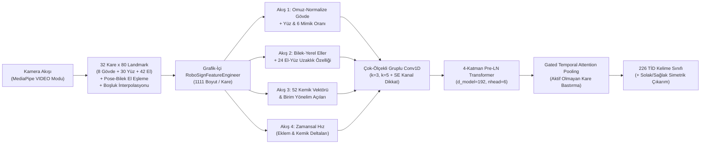

<div align="center">

# 🤟 RoboSignFormer

### Ultra-Lightweight 4-Stream Skeletal Conv-Transformer for Signer-Independent Turkish Sign Language Recognition on Edge Robotics

[](LICENSE)
[](MODEL_LICENSE.md)
[%20%7C%2092.04%25%20(Ensemble)-16a34a.svg)](#benchmark-sonuçları-autsl-226-sınıf--görülmemiş-işaretçi-protokolü)
[](#donanım-ve-gecikme-analizi)
[](#2-robot-ekibi-için-ros2--nvidia-jetson-orin-nano-kurulumu)
[](package.xml)

**Author / Geliştirici:** Abdullah Feyyaz Ekici

[**🇹🇷 Türkçe Dokümantasyon**](#-türkçe-dokümantasyon) • [**🇬🇧 English Documentation**](#-english-documentation) • [**📊 Benchmark**](#-benchmark-sonuçları-autsl-226-sınıf--görülmemiş-işaretçi-protokolü) • [**🚀 Quick Start**](#-hızlı-kurulum-ve-kullanım) • [**📚 Citation**](#-atıf--citation)

</div>

---

# 🇹🇷 Türkçe Dokümantasyon

## 🎯 Genel Bakış ve Motivasyon

Yardımcı hizmet robotlarında (**NVIDIA Jetson Orin Nano** vb. düşük güçlü gömülü sistemlerde) gerçek zamanlı Türk İşaret Dili (TİD) tanıma yapabilmek için ağır 3B-CNN veya Video-Transformer modellerinin yüksek bellek ve gecikme darboğazını aşmak gerekir. Bunun yanında gerçek dünya koşullarında:
1. Robot kamerası karşısına geçen kişiler modelin eğitiminde hiç görülmemiş (**signer-independent**) bireylerdir,
2. Kullanıcılar **solak veya sağlak** olabilir,
3. Kullanıcılar masa başında (kalça kadraj dışındayken) veya **cerrahi maske** takılıyken işaret yapabilir,
4. Aydınlatma, kıyafet ve arka plan sürekli değişir.

**RoboSignFormer**, bu gereksinimleri karşılamak üzere geliştirilmiş **1,74 Milyon parametreli (`108,20 MFLOPs`, TensorRT FP16 `~3,39 MB`)** 4-akışlı hibrit bir iskelet Conv-Transformer mimarisidir. Model, tüm geometrik normalizasyon ve 52 kemik açısı çıkarımını doğrudan `nn.Module` / ONNX grafiğinin içinde barındırır (`PyTorch vs ONNX maks. sapma = 1.79e-06`) ve **AUTSL** veri setinin 226 sınıflı resmi **görülmemiş işaretçi (unseen-signer)** test ayrımında tekil model olarak **%91,37 Top-1 (%98,00 Top-5)**, 3-tohum topluluğunda (ensemble) ise **%92,04 Top-1 (%98,56 Top-5)** doğruluk elde eder.

---

## 🏗️ Mimari Yapı ve Teknik Yenilikler



### Öne Çıkan Mühendislik Özellikleri
* **Grafik-İçi Geometrik Özellik Mühendisliği (`1111-D / Kare`):** Ham `(B, 32, 80, 3)` tensörü doğrudan ONNX modeline girer; omuz açıklığına göre ölçek değişmezliği, bilek-merkezli yerel parmak koordinatları, **24 kritik el–yüz temas mesafesi** (alın, burun, çene, yanak, ağız temasları), **52 anatomik kemik birim vektörü** ve zamansal hız türevleri model grafiğinin içinde hesaplanır.
* **4-Akışlı Uzmanlaşmış Kodlayıcı + Pre-LN Transformer:** Gövde/Mimik, El Şekli/Temas, Kemik Açısı ve Hareket Hızı akışları ayrı çok-ölçekli `Conv1D` (`k=3`, `k=5`) bloklarında işlendikten sonra birleştirilerek 4 katmanlı Pre-LN Transformer (`d=192`, `6` kafa) ve **Gated Temporal Attention Pooling** katmanına aktarılır.
* **Cerrahi Maske Bağışıklığı (`face_ok` Gating):** İşaretçinin yüzünün maskeli olduğu veya kadrajdan çıktığı karelerde yüz/mimik kanalları otomatik olarak sıfırlanır; model Gövde + El + Kemik Açıları üzerinden kesintisiz çalışmaya devam eder.
* **Solak / Sağlak (Handedness) Değişmezliği:** Çalışma zamanında anatomik yatay simetri (`_mirror_seq80`: sol/sağ omuz-dirsek-bilek, 10 çift simetrik yüz noktası ve sol/sağ el takası) ile kullanıcı işareti ister sağ eliyle ister sol eliyle yapsın aynı doğrulukla tanınır.
* **Topluluktan Tekil Jetson Öğrencisine Bilgi Damıtma (Knowledge Distillation):** 3 bağımsız tohum modelinin (`Seeds: 42, 123, 2026`) yumuşak olasılık dağılımı ($\tau = 3.0$) tek bir `1,74M` parametreli öğrenci modele damıtılarak tek geçişte `%91,37` test başarısı sağlanmıştır.

### 📐 Giriş Tensör Şeması `(B, 32, 80, 3)`
| İndeks Aralığı | Bölge | Eklem Sayısı | Açıklama |
| :--- | :--- | :---: | :--- |
| `0 .. 7` | **Üst Gövde (`Pose`)** | `8` | Sol/Sağ Omuz (`11,12`), Dirsek (`13,14`), Bilek (`15,16`), Kalça (`23,24`) |
| `8 .. 37` | **Yüz & Mimik (`Face`)** | `30` | `10` orta hat (alın, burun, dudaklar, çene) + `20` simetrik kaş, göz ve yanak noktası |
| `38 .. 58` | **Sol El (`Left Hand`)** | `21` | MediaPipe 21 el eklemi (`Pose` sol bilek Öklid eşleştirmeli) |
| `59 .. 79` | **Sağ El (`Right Hand`)** | `21` | MediaPipe 21 el eklemi (`Pose` sağ bilek Öklid eşleştirmeli) |

---

## 📊 Benchmark Sonuçları (AUTSL 226 Sınıf — Görülmemiş İşaretçi Protokolü)

| Yöntem | Giriş Türü | Sınıf Sayısı | Parametre | Test Top-1 | Test Top-5 |
| :--- | :--- | :---: | :---: | :---: | :---: |
| AUTSL Baseline *(Sincan & Keleş, 2020)* | RGB CNN + BiLSTM | 226 | — | %62,02 | — |
| TransSLR *(Yen, 2026)* | MediaPipe İskelet | 60 | 8,67 M | %80,39 | — |
| ST-GCN + Holistic *(Marais vd., 2025)* | MediaPipe İskelet | 226 | — | %88,95 | — |
| Graph-GRU *(Mederos vd., 2025)* | İskelet Grafiği | 226 | — | %90,04 *(Val)* | — |
| **RoboSignFormer (3-Seed Ortalama ± Std)** | **MediaPipe 80 Eklem** | **226** | **1,74 M** | **%90,95 ± 0,35** | **%98,00 ± 0,14** |
| **RoboSignFormer (Tekil Damıtılmış Öğrenci)** | **MediaPipe 80 Eklem** | **226** | **1,74 M** | **%91,37** | **%98,00** |
| **RoboSignFormer (3-Seed Ensemble)** | **MediaPipe 80 Eklem** | **226** | 3 × 1,74 M | **%92,04** | **%98,56** |

### ⚡ Donanım ve Gecikme Analizi (`batch_size = 1`)
| Metrik | Değer |
| :--- | :--- |
| **Parametre Sayısı** | `1.741.891` (`1,74 M`) |
| **Hesaplama Karmaşıklığı** | `108,20 MFLOPs` (`~54,10 MMACs`) |
| **Disk Boyutu** | `6,79 MB` (ONNX FP32) / `~3,39 MB` (TensorRT FP16) |
| **Tekil Model Çıkarım Süresi (CPU FP32)** | `5,16 ms` (`~194 tahmin/sn`) |
| **Uçtan Uca Kamera Boru Hattı (MediaPipe VIDEO + ONNX CPU)** | `39,43 ms` (`~25,4 FPS`) |

### 🎯 Gated Temporal Attention Pooling Görselleştirmesi (Aktif Kare Seçimi)

Klasik tekdüze ortalama (`1/32`, kırmızı kesikli çizgi) elin henüz kalkmadığı veya indiği boş kenar kareleri de hesaba katarak gürültü üretir. **RoboSignFormer** içindeki **Gated Temporal Attention Pooling** katmanı ise `0..6` ve `25..31` arasındaki boş/hazırlık karelerinin ağırlığını **`0.00`'a** bastırıp yalnızca işaretin anlam taşıdığı merkez karelere odaklanır:

<p align="center">
  
</p>

---

## 📂 Depo Klasör Yapısı

```text
RoboSignFormer/
├── assets/
│   └── gated_temporal_attention.png     # Gated Temporal Attention Pooling kare ağırlık analizi grafiği
├── models/
│   ├── robosignformer_jetson.onnx       # Dağıtıma hazır tek parça ONNX modeli (FP32, 6.8 MB)
│   ├── best_robosignformer_jetson.pt    # Damıtılmış PyTorch model ağırlıkları ve gömme (embedding) katmanı
│   ├── robosignformer_config.json       # 226 TİD sınıf haritası, landmark indeksleri ve 52 kemik tanımı
│   ├── pose_landmarker.task             # MediaPipe Pose VIDEO görev paketi
│   ├── face_landmarker.task             # MediaPipe Face VIDEO görev paketi
│   └── hand_landmarker.task             # MediaPipe Hand VIDEO görev paketi
├── robosignformer/
│   ├── __init__.py
│   ├── pipeline.py                      # Gerçek zamanlı durum makineli (IDLE/SIGNING) çıkarım motoru
│   └── sign_node.py                     # Tak-çalıştır ROS2 Humble / Jazzy kamera ve TTS düğümü
├── notebooks/
│   └── RoboSignFormer.ipynb             # Eğitim, ablasyon, bilgi damıtma ve ONNX dışa aktarma defteri
├── pc_webcam_demo.py                    # ROS2/PyTorch gerektirmeyen bağımsız PC canlı kamera uygulaması
├── package.xml & setup.py               # Standart ROS2 ament_python paket yapılandırması
├── requirements.txt                     # Minimal çalışma zamanı bağımlılıkları
├── LICENSE                              # Kaynak kodu lisansı (Apache-2.0)
├── MODEL_LICENSE.md                     # Model ağırlıkları lisansı (CC BY-NC 4.0)
└── CITATION.cff                         # Akademik atıf üstverisi
```

---

## 🚀 Hızlı Kurulum ve Kullanım

### 1) PC / Laptop Canlı Kamera Testi (ROS2 veya PyTorch Gerektirmez)
```bash
git clone https://github.com/feyyazekici/RoboSignFormer.git
cd RoboSignFormer
pip install -r requirements.txt
python pc_webcam_demo.py
```
* Kameranın karşısına geçip elinizi kaldırarak TİD işaretini yapın ve elinizi indirin; durum makinesi (`IDLE -> SIGNING -> IDLE`) aktif hareket bölgesini otomatik kırpıp 32 kareye örnekleyerek anında Türkçe kelime tahminini ve Top-3 olasılıklarını ekranda gösterir.
* Klavye kısayolları: **`[m]`** Ayna (selfie) görünümü aç/kapat • **`[q]`** Çıkış.

### 2) Python Kodu İçinden Kullanım (SDK)
```python
import cv2
from robosignformer.pipeline import RoboSignFormerPipeline

pipe = RoboSignFormerPipeline(conf_threshold=0.55, mirror_camera=False)
cap = cv2.VideoCapture(0)

while cap.isOpened():
    ok, frame = cap.read()
    if not ok:
        break
    word, score_pct, vis = pipe.process_frame(frame, draw_hud=True)
    if word:
        print(f"Algılanan TİD Kelimesi: {word} (%{score_pct})")
    cv2.imshow("RoboSignFormer", vis)
    if cv2.waitKey(1) & 0xFF == ord("q"):
        break

cap.release()
pipe.close()
```

### 3) Robot Ekibi İçin ROS2 & NVIDIA Jetson Orin Nano Kurulumu
```bash
cd ~/ros2_ws/src
git clone https://github.com/feyyazekici/RoboSignFormer.git
cd ~/ros2_ws
colcon build --packages-select robosignformer
source install/setup.bash

# (İsteğe Bağlı) Jetson Orin Nano üzerinde TensorRT FP16 motoru derleme:
/usr/src/tensorrt/bin/trtexec \
  --onnx=src/RoboSignFormer/models/robosignformer_jetson.onnx \
  --saveEngine=src/RoboSignFormer/models/robosignformer_fp16.engine \
  --fp16

# Düğümü başlat:
ros2 run robosignformer sign_node
```

#### 🔌 ROS2 Haberleşme Kanalları (Topics)
| Topic Adı | Mesaj Tipi | Yön | Açıklama |
| :--- | :--- | :---: | :--- |
| `/camera/image_raw` | `sensor_msgs/Image` | Giriş | Robot kamerasından gelen BGR/RGB ham görüntü akışı |
| **`/robodost/tts_speak`** | **`std_msgs/String`** | **Çıkış** | Algılanan Türkçe kelimeyi doğrudan Piper TTS seslendirme düğümüne iletir |
| `/robodost/sign_update` | `VisionUpdate` / `std_msgs/String` | Çıkış | Yapılandırılmış JSON çıktısı (`word`, `confidence`, `top3`) |

---
---

# 🇬🇧 English Documentation

## 🎯 Overview

**RoboSignFormer** is an ultra-lightweight (**1.74M parameters**, **108.20 MFLOPs**, `~3.39 MB` in FP16) 4-stream skeletal Conv-Transformer engineered for real-time **signer-independent Turkish Sign Language (TİD)** recognition on embedded assistive robots (**NVIDIA Jetson Orin Nano**) and standard CPUs.

Unlike heavy RGB video backbones that suffer from lighting shifts, background clutter, signer appearance bias, and high memory footprints, **RoboSignFormer** embeds all geometric normalization and anatomical bone-vector computation directly inside its exported computation graph (`PyTorch vs. ONNX max discrepancy = 1.79e-06`). On the official **226-class AUTSL unseen-signer test benchmark**, a single distilled student achieves **91.37% Top-1 (98.00% Top-5)** accuracy, while the 3-seed ensemble reaches **92.04% Top-1 (98.56% Top-5)**.

### Key Capabilities
* **In-Graph `1111-D` Biomechanical Feature Engineering:** Accepts raw `(B, 32, 80, 3)` MediaPipe VIDEO landmarks and computes shoulder-span normalized body/face coordinates, 6 non-manual facial expression ratios (eyebrow raise, eye aperture, mouth opening), wrist-local hand coordinates, **24 hand-to-face proximity features**, **52 anatomical unit bone vectors**, and first-order temporal velocities inside the ONNX graph.
* **4-Stream Multi-Scale Conv1D + 4-Layer Pre-LN Transformer:** Dedicated local temporal convolutions (`k=3, 5`) per modality followed by global self-attention (`d_model=192, nhead=6`) and **Gated Temporal Attention Pooling** to suppress idle boundary frames.
* **Surgical Mask Immunity (`face_ok` Gating):** Automatically masks out facial streams when the signer wears a face mask or steps partially out of frame, maintaining robust recognition via upper-body + hand + bone streams.
* **Handedness-Invariant Inference:** Evaluates anatomical horizontal reflection (`_mirror_seq80`) at runtime so both left-handed and right-handed signers achieve identical accuracy without retraining.
* **Plug-and-Play Edge Deployment:** Ships with self-contained ONNX weights, MediaPipe `.task` bundles, a zero-ROS standalone webcam runner (`pc_webcam_demo.py`), and a native ROS2 Humble/Jazzy node (`sign_node`).

### Quick Start (English)
```bash
git clone https://github.com/feyyazekici/RoboSignFormer.git
cd RoboSignFormer
pip install -r requirements.txt
python pc_webcam_demo.py
```

---

## 📄 Lisans / License

* **Kaynak Kodu / Source Code:** [Apache License 2.0](LICENSE) — Telif Hakkı / Copyright © 2026 **Abdullah Feyyaz Ekici**.
* **Eğitilmiş Model Ağırlıkları / Pretrained Weights:** `AUTSL` veri setinin akademik paylaşım koşulları gereği eğitilmiş ağırlıklar (`robosignformer_jetson.onnx`, `best_robosignformer_jetson.pt`) [CC BY-NC 4.0](MODEL_LICENSE.md) (Ticari Olmayan Akademik/Araştırma Kullanımı) lisansı ile sunulmaktadır. Ticari kullanım için mimari ticari izinli veriyle yeniden eğitilebilir veya veri seti sahiplerinden yetki alınabilir.

---

## 📚 Atıf / Citation

Bu modeli, mimariyi veya çıkarım boru hattını akademik çalışmalarınızda ya da robotik projelerinizde kullanırsanız lütfen aşağıdaki şekilde atıf yapınız / If you use **RoboSignFormer** in your research or robotics system, please cite:

```bibtex
@software{ekici2026robosignformer,
  author       = {Ekici, Abdullah Feyyaz},
  title        = {RoboSignFormer: An Ultra-Lightweight 4-Stream Skeletal Conv-Transformer for Signer-Independent Turkish Sign Language Recognition on Edge Robotics},
  year         = {2026},
  version      = {1.0.0},
  license      = {Apache-2.0}
}
```
