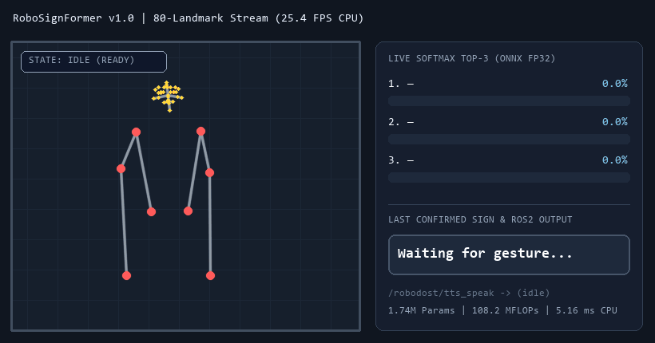
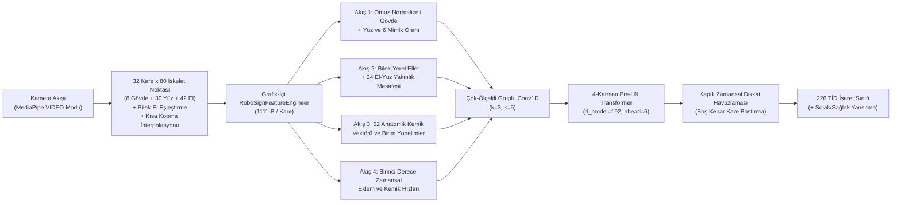
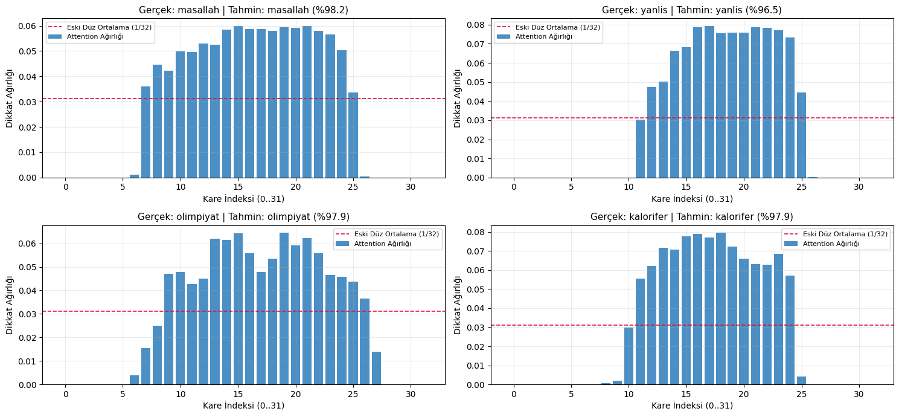
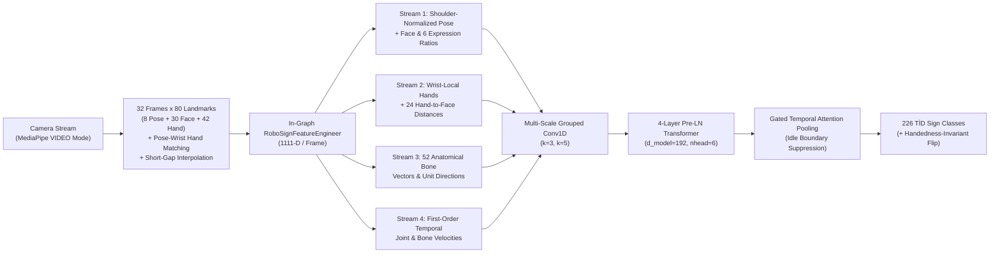

<div align="center">

# 🤟 RoboSignFormer

### Uç Robotik Sistemler İçin Ultra-Hafif 4-Akışlı İskelet Conv-Transformer Türk İşaret Dili (TİD) Tanıma Mimarisi
*Ultra-Lightweight 4-Stream Skeletal Conv-Transformer for Signer-Independent Turkish Sign Language Recognition on Edge Robotics*

[](LICENSE)
[](MODEL_LICENSE.md)
[%20%7C%2092.04%25%20(Ensemble)-16a34a.svg)](#benchmarks-tr)
[](#latency-tr)
[](#ros2-tr)
[](package.xml)
[](https://github.com/feyyazekici/RoboSignFormer/releases)

**Geliştirici / Author:** Abdullah Feyyaz Ekici

[**🇹🇷 Türkçe Dokümantasyon**](#tr-docs) • [**🇬🇧 English Documentation**](#en-docs) • [**📊 Benchmarklar**](#benchmarks-tr) • [**⚡ Gecikme**](#latency-tr) • [**🚀 Hızlı Kurulum**](#quickstart-tr) • [**📚 Atıf / Citation**](#citation)

<br />



*Gerçek `robosignformer_jetson.onnx` (`1,74M` parametre, `5,16 ms` CPU) ile çalışan `IDLE → SIGNING → CONFIRMED` durum makinesi (`SELAM → TESEKKUR → HASTANE`) ve `/robodost/tts_speak` ROS2 yayını.*

</div>

---

<a id="tr-docs"></a>

# 🇹🇷 Türkçe Dokümantasyon

## 1. Genel Bakış ve Motivasyon

Düşük güç tüketimli yardımcı hizmet robotlarında (**NVIDIA Jetson Orin Nano 8GB** vb.) gerçek zamanlı Türk İşaret Dili (TİD) tanıma yapabilmek için ağır 3B-CNN ve Video-Transformer modellerinin yüksek bellek, güç ve gecikme darboğazlarını aşmak gerekir. Ayrıca gerçek saha kullanımında şu zorluklar aynı anda ortaya çıkar:
1. **Görülmemiş İşaretçiler (Signer-Independent Genelleme):** Robot kamerası karşısına geçen bireyler eğitim kümesinde yer almayan kişilerdir.
2. **Solak / Sağlak Değişmezliği:** Kullanıcılar işareti sağ veya sol baskın elleriyle gerçekleştirebilir.
3. **Cerrahi Maske ve Kısmi Kadraj:** Kullanıcılar cerrahi maske takabilir veya masa başında otururken alt gövde eklemleri kamera kadrajı dışında kalabilir.
4. **Aydınlatma ve Arka Plan Gürültüsü:** Görünüm tabanlı RGB video modelleri stüdyo dışı ortamlarda hızla performans kaybeder.

**RoboSignFormer**, bu kısıtları aşmak için geliştirilmiş **1,74 Milyon parametreli (`108,20 MFLOPs`, `6,79 MB` ONNX FP32 / `~3,39 MB` TensorRT FP16)** 4-akışlı hibrit bir iskelet Conv-Transformer mimarisidir. Tüm biyomekanik normalizasyon ve 52 kemik yönelim hesabı doğrudan `nn.Module` / ONNX hesaplama grafiğinin içine gömülüdür (`PyTorch vs. ONNX maks. sayısal fark = 1.79e-06`). Resmi **226 sınıflı AUTSL görülmemiş işaretçi (unseen-signer) test ayrımında** tekil damıtılmış öğrenci model **%91,37 Top-1 (%98,00 Top-5)**, 3-tohum topluluğu (ensemble) ise **%92,04 Top-1 (%98,56 Top-5)** doğruluk elde eder.

---

## 2. Mimari ve Teknik Yenilikler



### Temel Mimari Öne Çıkanlar
* **Grafik-İçi `1111-B` Biyomekanik Özellik Mühendisliği:** Ham `(B, 32, 80, 3)` MediaPipe VIDEO koordinatlarını doğrudan giriş olarak alır; omuz açıklığına göre ölçek değişmezliği, 6 el-dışı yüz mimik oranı (kaş kalkıklığı, göz açıklığı, ağız açıklığı), bilek-yerel parmak geometrisi, **24 el–yüz yakınlık mesafesi** (alın, burun, dudak, çene, yanak), **52 birim kemik vektörü** ve zamansal hız türevlerini doğrudan ONNX/TensorRT grafiği içinde hesaplar.
* **4-Akışlı Çok-Ölçekli Conv1D + 4-Katman Pre-LN Transformer:** Her kinematik akışı kendi çok-ölçekli zamansal evrişim katmanlarından (`k=3, k=5`) geçirir; ardından 4 katmanlı Pre-LN Transformer (`d_model=192, nhead=6`) ve **Kapılı Zamansal Dikkat Havuzlaması (Gated Temporal Attention Pooling)** ile kareler arası küresel füzyon yapar.
* **Cerrahi Maske Bağışıklığı (`face_ok` Kapılaması):** Yüz noktaları maske veya kadraj dışı kalma nedeniyle kaybolduğunda yüz/mimik kanallarını otomatik sıfırlar; üst gövde, el ve kemik açısı akışlarıyla tanıma doğruluğunu korur.
* **Çalışma Zamanında Solak / Sağlak Değişmezliği:** Anatomik yatay yansıtmayı (`_mirror_seq80`: sol/sağ omuz-dirsek-bilek-kalça, 10 çift simetrik yüz noktası ve sol/sağ el takası) değerlendirerek hem solak hem sağlak kullanıcılar için yeniden eğitim gerekmeden aynı doğruluğu sunar.
* **Topluluktan Öğrenciye Bilgi Damıtma (Knowledge Distillation):** 3 bağımsız öğretmen tohumundan (`Seeds: 42, 123, 2026`) elde edilen yumuşak hedefler ($\tau = 3.0$) tek geçişli uç çıkarım için `1,74M` parametreli tekil öğrenci modele damıtılmıştır.

### Giriş Tensörü Şeması `(B, 32, 80, 3)`
| İndeks Aralığı | Bölge | Nokta Sayısı | Açıklama |
| :--- | :--- | :---: | :--- |
| `0 .. 7` | **Üst Gövde (`Pose`)** | `8` | Sol/Sağ Omuz (`11,12`), Dirsek (`13,14`), Bilek (`15,16`), Kalça (`23,24`) |
| `8 .. 37` | **Yüz ve Mimikler (`Face`)** | `30` | `10` orta hat noktası (alın, burun, dudak, çene) + `20` simetrik kaş/göz/yanak çifti |
| `38 .. 58` | **Sol El (`LH`)** | `21` | `Pose` sol bileğine anatomik eşlenmiş 21 MediaPipe el eklemi |
| `59 .. 79` | **Sağ El (`RH`)** | `21` | `Pose` sağ bileğine anatomik eşlenmiş 21 MediaPipe el eklemi |

---

<a id="benchmarks-tr"></a>

## 3. Benchmark Sonuçları (AUTSL 226 Sınıf — Resmi Görülmemiş İşaretçi Test Ayrımı)

| Yöntem | Giriş Modalitesi | Sınıf | Parametre | Test Top-1 | Test Top-5 |
| :--- | :--- | :---: | :---: | :---: | :---: |
| AUTSL Baseline *(Sincan & Keleş, 2020)* | RGB CNN + BiLSTM | 226 | — | %62,02 | — |
| TransSLR *(Yen, 2026)* | MediaPipe İskelet | 60 | 8,67M | %80,39 | — |
| ST-GCN + Holistic *(Marais et al., 2025)* | MediaPipe İskelet | 226 | — | %88,95 | — |
| Graph-GRU *(Mederos et al., 2025)* | İskelet Grafı | 226 | — | %90,04 *(Doğrulama)* | — |
| **RoboSignFormer (3-Tohum Ort. ± Std)** | **MediaPipe 80-Nokta** | **226** | **1,74M** | **%90,95 ± 0,35** | **%98,00 ± 0,14** |
| **RoboSignFormer (Tekil Damıtılmış Öğrenci)** | **MediaPipe 80-Nokta** | **226** | **1,74M** | **%91,37** | **%98,00** |
| **RoboSignFormer (3-Tohum Topluluğu / Ensemble)** | **MediaPipe 80-Nokta** | **226** | 3 × 1,74M | **%92,04** | **%98,56** |

<a id="latency-tr"></a>

### ⚡ Donanım Karmaşıklığı ve Gecikme Profili (`batch_size = 1`)

| Metrik / Çalışma Hedefi | Ölçülen Değer | Notlar |
| :--- | :--- | :--- |
| **Parametre Sayısı ve FLOPs** | `1.741.891` (`1,74M`) • `108,20 MFLOPs` | 32 karelik klip başına `~54,10 MMACs` |
| **Serileştirilmiş Model Boyutu** | `6,79 MB` (ONNX FP32) • `~3,39 MB` (TRT FP16) | Çıkarım sırasında tepe GPU VRAM: **`91,46 MB`** |
| **CPU Çıkarım Gecikmesi (ONNXRuntime FP32)** | **`5,16 ms`** ort. (`5,34 ms` P95 • `194 inf/s`) | Tek klip ileri geçişi (`1 × 32 × 80 × 3`) |
| **CUDA GPU Çıkarım Gecikmesi (PyTorch AMP FP16)** | **`7,89 ± 0,20 ms`** (`7,85 ms` P50 • `8,03 ms` P95) | Bulut CUDA GPU ölçümü (`batch_size = 1`) |
| **MediaPipe VIDEO İskelet Çıkarımı (`640×480`)** | `34,27 ms` / kare (`35,41 ms` P95) | `pose_landmarker_lite` + `face` + `hand` (`VIDEO` takip modu) |
| **Uçtan Uca CPU Boru Hattı (MediaPipe + ONNX)** | **`39,43 ms` / kare (`~25,4 FPS`)** | Harici GPU gerektirmez |
| **NVIDIA Jetson Orin Nano 8GB (TensorRT FP16)** | *Hedef Uç Platformu (`JetPack 6`)* | Grafik doğrulandı (`PyTorch vs ONNX farkı = 1.79e-06`, `91,5 MB` VRAM); fiziksel kart üstü `trtexec` ölçümü bekleniyor |

### 🎯 Kapılı Zamansal Dikkat Havuzlaması (Gated Temporal Attention Pooling)

Standart tekdüze ortalama alma (`1/32`, kesikli kırmızı çizgi), işaret temsilini başlangıç/bitiş bekleme kareleriyle seyreltir. **Kapılı Zamansal Dikkat Havuzlaması**, boş kenar karelerini (`0..6` ve `25..31`) **`0,00`** seviyesine bastırırken ağırlığı etkin işaret çekirdeğine odaklar:

<p align="center">
  
</p>

---

## 4. Depo Yapısı ve Ağırlık Yönetimi

```text
RoboSignFormer/
├── assets/
│   ├── robosignformer_live_demo.gif     # Canlı durum makinesi ve ONNX Top-3 telemetri demosu
│   └── gated_temporal_attention.png     # Kapılı Zamansal Dikkat Havuzlaması ağırlık dağılımı
├── models/
│   ├── robosignformer_jetson.onnx       # Bağımsız ONNX FP32 model (6,8 MB, grafik-içi özellikler)
│   ├── best_robosignformer_jetson.pt    # Damıtılmış PyTorch ağırlık dosyası (6,8 MB)
│   ├── robosignformer_config.json       # 226 sınıf sözlüğü, eklem indeksleri ve 52 kemik çifti
│   └── {pose,face,hand}_landmarker.task # MediaPipe VIDEO görev paketleri
├── robosignformer/
│   ├── __init__.py
│   ├── pipeline.py                      # ONNXRuntime / TensorRT .engine durum makinesi boru hattı
│   └── sign_node.py                     # ROS2 Humble / Jazzy kamera ve TTS yayın düğümü
├── notebooks/
│   └── RoboSignFormer.ipynb             # Tekrarlanabilir eğitim, damıtma ve ONNX dışa aktarım defteri
├── pc_webcam_demo.py                    # Bağımsız PC canlı kamera uygulaması (ROS2/PyTorch gerektirmez)
├── package.xml & setup.py               # ROS2 ament_python derleme yapılandırması
├── requirements.txt                     # Minimal çalışma zamanı bağımlılıkları
└── LICENSE, MODEL_LICENSE.md, NOTICE, CITATION.cff
```

> **Ağırlık Depolama Politikası:** Temel `v1.0.0` çalışma zamanı dosyaları (toplam `~30,7 MB`, her dosya `< 8 MB`) çevrimdışı robotik iş istasyonlarında tek komutla kurulum için repoda yer almakta ve [**GitHub Releases (`v1.0.0`)**](https://github.com/feyyazekici/RoboSignFormer/releases) altında arşivlenmektedir. Sonraki model sürümleri (`v1.1+`) Git geçmişini kompakt tutmak amacıyla yalnızca GitHub Releases üzerinden dağıtılacaktır.

---

<a id="quickstart-tr"></a>

## 5. Hızlı Kurulum ve Dağıtım

### A) Bağımsız PC / Dizüstü Canlı Kamera Demosu (ROS2 veya PyTorch Gerektirmez)
```bash
git clone https://github.com/feyyazekici/RoboSignFormer.git
cd RoboSignFormer
pip install -r requirements.txt
python pc_webcam_demo.py
```
* Elinizi bel hizasının üzerine kaldırıp TİD işaretini yapın ve indirin; `IDLE → SIGNING → IDLE` durum makinesi etkin klibi otomatik bölütler, 32 kareye yeniden örnekler ve Top-3 tahminlerini gösterir.
* Kontroller: **`[m]`** ayna görüntüsü aç/kapat • **`[q]`** çıkış.

### B) Python SDK Kullanımı
```python
import cv2
from robosignformer.pipeline import RoboSignFormerPipeline

pipe = RoboSignFormerPipeline(conf_threshold=0.55, mirror_camera=False)
cap = cv2.VideoCapture(0)

while cap.isOpened():
    ok, frame = cap.read()
    if not ok:
        break
    word, score_pct, vis = pipe.process_frame(frame, draw_hud=True)
    if word:
        print(f"Onaylanan TİD İşareti: {word} (%{score_pct})")
    cv2.imshow("RoboSignFormer", vis)
    if cv2.waitKey(1) & 0xFF == ord("q"):
        break

cap.release()
pipe.close()
```

<a id="ros2-tr"></a>

### C) ROS2 Humble / Jazzy ve NVIDIA Jetson Orin Nano TensorRT Dağıtımı
```bash
cd ~/ros2_ws/src
git clone https://github.com/feyyazekici/RoboSignFormer.git
cd ~/ros2_ws
colcon build --packages-select robosignformer
source install/setup.bash

# Seçenek 1 — Otomatik ONNXRuntime-TensorRT FP16 Motor Önbellekleme (Jetson Varsayılanı):
ros2 run robosignformer sign_node --ros-args -p trt_fp16:=true

# Seçenek 2 — trtexec ile Önceden Derlenmiş Bağımsız TensorRT FP16 (.engine):
/usr/src/tensorrt/bin/trtexec \
  --onnx=src/RoboSignFormer/models/robosignformer_jetson.onnx \
  --saveEngine=src/RoboSignFormer/models/robosignformer_fp16.engine \
  --fp16

ros2 run robosignformer sign_node --ros-args \
  -p engine_path:=src/RoboSignFormer/models/robosignformer_fp16.engine \
  -p conf_threshold:=0.55
```

#### ROS2 Topic ve Parametre Arayüzü
| Topic / Parametre | Tür | Yön | Açıklama |
| :--- | :--- | :---: | :--- |
| `/camera/image_raw` | `sensor_msgs/Image` | Giriş | Ham BGR/RGB kamera akışı (`camera_topic` parametresi) |
| **`/robodost/tts_speak`** | **`std_msgs/String`** | **Çıkış** | Alt akış TTS düğümleri (ör. Piper) için tanınan Türkçe kelime |
| `/robodost/sign_update` | `VisionUpdate` / `String` | Çıkış | Yapılandırılmış JSON (`kelime`, `guven_skoru`, `nesne_bulundu`) |
| `/robodost/sign_debug_image` | `sensor_msgs/Image` | Çıkış | İskelet HUD akışı (yalnızca abone varken tembel işlenir) |
| `engine_path` / `trt_fp16` | `string` / `bool` | Param | Derlenmiş `.engine` yolu veya ONNXRuntime-TRT önbellekleme için `trt_fp16:=true` |

---
---

<a id="en-docs"></a>

# 🇬🇧 English Documentation

## 1. Overview & Motivation

Deploying real-time Sign Language Recognition (SLR) on low-power assistive service robots (such as **NVIDIA Jetson Orin Nano 8GB**) requires overcoming the severe memory, power, and latency bottlenecks of 3D-CNN and Video-Transformer backbones while remaining robust to real-world conditions:
1. **Unseen Signers (Signer-Independent Generalization):** Users interacting with an assistive robot are never part of the training set.
2. **Handedness Invariance:** Signers may perform gestures using either their right or left dominant hand.
3. **Face Masks & Partial Framing:** Signers may wear surgical masks or sit at a desk with lower-body joints outside the camera field of view.
4. **Lighting & Background Clutter:** Appearance-based RGB models degrade rapidly outside studio environments.

**RoboSignFormer** addresses these constraints through a **1.74M-parameter (`108.20 MFLOPs`, `6.79 MB` ONNX FP32 / `~3.39 MB` TensorRT FP16)** 4-stream skeletal Conv-Transformer. All biomechanical normalization and 52-bone orientation computations are embedded directly inside the `nn.Module` / ONNX computation graph (`PyTorch vs. ONNX max numerical discrepancy = 1.79e-06`). On the official **226-class AUTSL signer-independent test split**, a single distilled student model achieves **91.37% Top-1 (98.00% Top-5)** accuracy, while the 3-seed ensemble reaches **92.04% Top-1 (98.56% Top-5)**.

---

## 2. Architecture & Technical Innovations



### Key Architectural Highlights
* **In-Graph `1111-D` Biomechanical Feature Engineering:** Takes raw `(B, 32, 80, 3)` MediaPipe VIDEO coordinates directly as input and computes shoulder-span scale invariance, 6 non-manual facial expression ratios (eyebrow elevation, eye aperture, mouth opening), wrist-local finger geometry, **24 hand-to-face proximity distances** (forehead, nose, lips, chin, cheeks), **52 unit bone vectors**, and temporal velocities inside the ONNX/TensorRT graph.
* **4-Stream Multi-Scale Conv1D + 4-Layer Pre-LN Transformer:** Processes each kinematic modality through dedicated multi-scale temporal convolutions (`k=3, k=5`) before global cross-frame fusion via a 4-layer Pre-LN Transformer (`d_model=192, nhead=6`) and **Gated Temporal Attention Pooling**.
* **Surgical Face-Mask Immunity (`face_ok` Gating):** Automatically zeroes out facial/expression channels when facial landmarks are occluded or masked, preserving recognition accuracy via upper-body, hand, and bone-angle streams.
* **Handedness-Invariant Runtime Inference:** Evaluates anatomical horizontal reflection (`_mirror_seq80`: swapping left/right shoulders, elbows, wrists, hips, 10 symmetric facial landmark pairs, and left/right hands) so both left-handed and right-handed signers achieve identical accuracy without model retraining.
* **Ensemble-to-Student Knowledge Distillation:** Soft targets ($\tau = 3.0$) from 3 independent teacher seeds (`Seeds: 42, 123, 2026`) are distilled into a single `1.74M`-parameter student for single-pass edge execution.

### Input Tensor Specification `(B, 32, 80, 3)`
| Index Slice | Region | Landmarks | Description |
| :--- | :--- | :---: | :--- |
| `0 .. 7` | **Upper Body (`Pose`)** | `8` | Left/Right Shoulder (`11,12`), Elbow (`13,14`), Wrist (`15,16`), Hip (`23,24`) |
| `8 .. 37` | **Face & Expressions (`Face`)** | `30` | `10` midline landmarks (forehead, nose, lips, chin) + `20` symmetric brow/eye/cheek pairs |
| `38 .. 58` | **Left Hand (`LH`)** | `21` | 21 MediaPipe hand joints matched anatomically to `Pose` left wrist |
| `59 .. 79` | **Right Hand (`RH`)** | `21` | 21 MediaPipe hand joints matched anatomically to `Pose` right wrist |

---

<a id="benchmarks-en"></a>

## 3. Benchmark Results (AUTSL 226 Classes — Unseen-Signer Official Test Split)

| Method | Input Modality | Classes | Params | Test Top-1 | Test Top-5 |
| :--- | :--- | :---: | :---: | :---: | :---: |
| AUTSL Baseline *(Sincan & Keleş, 2020)* | RGB CNN + BiLSTM | 226 | — | 62.02% | — |
| TransSLR *(Yen, 2026)* | MediaPipe Skeleton | 60 | 8.67M | 80.39% | — |
| ST-GCN + Holistic *(Marais et al., 2025)* | MediaPipe Skeleton | 226 | — | 88.95% | — |
| Graph-GRU *(Mederos et al., 2025)* | Skeletal Graph | 226 | — | 90.04% *(Val)* | — |
| **RoboSignFormer (3-Seed Mean ± Std)** | **MediaPipe 80-Landmark** | **226** | **1.74M** | **90.95% ± 0.35** | **98.00% ± 0.14** |
| **RoboSignFormer (Single Distilled Student)** | **MediaPipe 80-Landmark** | **226** | **1.74M** | **91.37%** | **98.00%** |
| **RoboSignFormer (3-Seed Ensemble)** | **MediaPipe 80-Landmark** | **226** | 3 × 1.74M | **92.04%** | **98.56%** |

<a id="latency-en"></a>

### ⚡ Hardware Complexity & Latency Profile (`batch_size = 1`)

| Metric / Execution Target | Measured Value | Notes |
| :--- | :--- | :--- |
| **Parameter Count & FLOPs** | `1,741,891` (`1.74M`) • `108.20 MFLOPs` | `~54.10 MMACs` per 32-frame clip |
| **Serialized Model Size** | `6.79 MB` (ONNX FP32) • `~3.39 MB` (TRT FP16) | Peak GPU VRAM during inference: **`91.46 MB`** |
| **CPU Inference Latency (ONNXRuntime FP32)** | **`5.16 ms`** mean (`5.34 ms` P95 • `194 inf/s`) | Single-clip forward pass (`1 × 32 × 80 × 3`) |
| **CUDA GPU Inference Latency (PyTorch AMP FP16)** | **`7.89 ± 0.20 ms`** (`7.85 ms` P50 • `8.03 ms` P95) | Measured on cloud CUDA GPU (`batch_size = 1`) |
| **MediaPipe VIDEO Extraction (`640×480`)** | `34.27 ms` / frame (`35.41 ms` P95) | `pose_landmarker_lite` + `face` + `hand` (`VIDEO` tracking mode) |
| **End-to-End CPU Pipeline (MediaPipe + ONNX)** | **`39.43 ms` / frame (`~25.4 FPS`)** | Zero discrete GPU required |
| **NVIDIA Jetson Orin Nano 8GB (TensorRT FP16)** | *Target Edge Platform (`JetPack 6`)* | Graph verified (`PyTorch vs ONNX diff = 1.79e-06`, `91.5 MB` VRAM); physical on-board `trtexec` timing pending |

---

## 4. Repository Structure & Weight Management

```text
RoboSignFormer/
├── assets/
│   ├── robosignformer_live_demo.gif     # Live state-machine & ONNX Top-3 telemetry demo
│   └── gated_temporal_attention.png     # Gated Temporal Attention Pooling weight distribution
├── models/
│   ├── robosignformer_jetson.onnx       # Self-contained ONNX FP32 model (6.8 MB, in-graph features)
│   ├── best_robosignformer_jetson.pt    # Distilled PyTorch checkpoint (6.8 MB)
│   ├── robosignformer_config.json       # 226-class vocabulary, landmark indices & 52 bone pairs
│   └── {pose,face,hand}_landmarker.task # MediaPipe VIDEO task bundles
├── robosignformer/
│   ├── __init__.py
│   ├── pipeline.py                      # ONNXRuntime / TensorRT .engine state-machine pipeline
│   └── sign_node.py                     # ROS2 Humble / Jazzy camera & TTS publisher node
├── notebooks/
│   └── RoboSignFormer.ipynb             # Reproducible training, distillation & ONNX export notebook
├── pc_webcam_demo.py                    # Standalone PC webcam runner (no ROS2 or PyTorch needed)
├── package.xml & setup.py               # ROS2 ament_python build configuration
├── requirements.txt                     # Minimal runtime dependencies
└── LICENSE, MODEL_LICENSE.md, NOTICE, CITATION.cff
```

> **Weight Storage Policy:** Baseline `v1.0.0` runtime artifacts (`~30.7 MB` total, each file `< 8 MB`) are included for zero-friction single-command setup on offline robotics workstations and archived under [**GitHub Releases (`v1.0.0`)**](https://github.com/feyyazekici/RoboSignFormer/releases). Subsequent model checkpoints (`v1.1+`) are distributed exclusively via GitHub Releases to keep Git history compact.

---

<a id="quickstart-en"></a>

## 5. Quick Start & Deployment

### A) Standalone PC / Laptop Live Webcam Demo (No ROS2 or PyTorch Required)
```bash
git clone https://github.com/feyyazekici/RoboSignFormer.git
cd RoboSignFormer
pip install -r requirements.txt
python pc_webcam_demo.py
```
* Raise your hand above waist level to perform a TİD sign, then lower your hand; the `IDLE → SIGNING → IDLE` state machine automatically segments the active clip, resamples to 32 frames, and displays Top-3 predictions.
* Controls: **`[m]`** toggle mirror view • **`[q]`** quit.

### B) Python SDK Usage
```python
import cv2
from robosignformer.pipeline import RoboSignFormerPipeline

pipe = RoboSignFormerPipeline(conf_threshold=0.55, mirror_camera=False)
cap = cv2.VideoCapture(0)

while cap.isOpened():
    ok, frame = cap.read()
    if not ok:
        break
    word, score_pct, vis = pipe.process_frame(frame, draw_hud=True)
    if word:
        print(f"Confirmed TİD Sign: {word} ({score_pct}%)")
    cv2.imshow("RoboSignFormer", vis)
    if cv2.waitKey(1) & 0xFF == ord("q"):
        break

cap.release()
pipe.close()
```

<a id="ros2-en"></a>

### C) ROS2 Humble / Jazzy & NVIDIA Jetson Orin Nano TensorRT Deployment
```bash
cd ~/ros2_ws/src
git clone https://github.com/feyyazekici/RoboSignFormer.git
cd ~/ros2_ws
colcon build --packages-select robosignformer
source install/setup.bash

# Option 1 — Automatic ONNXRuntime-TensorRT FP16 Engine Caching (Default on Jetson):
ros2 run robosignformer sign_node --ros-args -p trt_fp16:=true

# Option 2 — Pre-compiled Standalone TensorRT FP16 .engine via trtexec:
/usr/src/tensorrt/bin/trtexec \
  --onnx=src/RoboSignFormer/models/robosignformer_jetson.onnx \
  --saveEngine=src/RoboSignFormer/models/robosignformer_fp16.engine \
  --fp16

ros2 run robosignformer sign_node --ros-args \
  -p engine_path:=src/RoboSignFormer/models/robosignformer_fp16.engine \
  -p conf_threshold:=0.55
```

#### ROS2 Topics & Parameters
| Topic / Parameter | Type | Direction | Description |
| :--- | :--- | :---: | :--- |
| `/camera/image_raw` | `sensor_msgs/Image` | Input | Raw BGR/RGB camera stream (`camera_topic` param) |
| **`/robodost/tts_speak`** | **`std_msgs/String`** | **Output** | Recognized Turkish gloss published for downstream TTS nodes (e.g., Piper) |
| `/robodost/sign_update` | `VisionUpdate` / `String` | Output | Structured JSON (`kelime`, `guven_skoru`, `nesne_bulundu`) |
| `/robodost/sign_debug_image` | `sensor_msgs/Image` | Output | Annotated skeletal HUD stream (rendered lazily only when subscribed) |
| `engine_path` / `trt_fp16` | `string` / `bool` | Param | Path to compiled `.engine` file, or `trt_fp16:=true` for ONNXRuntime-TRT caching |

---

## 📄 Lisans / License

* **Kaynak Kodu / Source Code:** [Apache License 2.0](LICENSE) — Copyright © 2026 **Abdullah Feyyaz Ekici**.
* **Eğitilmiş Model Ağırlıkları / Pretrained Weights:** **AUTSL** veri setinin *(Sincan & Keleş, 2020)* akademik ticari olmayan paylaşım koşulları doğrultusunda [CC BY-NC 4.0](MODEL_LICENSE.md) altında sunulmaktadır. Üçüncü parti bileşen bildirimleri için [NOTICE](NOTICE) dosyasına bakınız.

---

<a id="citation"></a>

## 📚 Atıf / Citation

**RoboSignFormer** projesini akademik çalışmalarınızda, tezinizde veya robotik sistemlerinizde kullanırsanız lütfen aşağıdaki şekilde atıf yapınız / If you use **RoboSignFormer** in your research, thesis, or robotics system, please cite:

```bibtex
@software{ekici2026robosignformer,
  author       = {Ekici, Abdullah Feyyaz},
  title        = {RoboSignFormer: An Ultra-Lightweight 4-Stream Skeletal Conv-Transformer for Signer-Independent Turkish Sign Language Recognition on Edge Robotics},
  year         = {2026},
  version      = {1.0.0},
  url          = {https://github.com/feyyazekici/RoboSignFormer},
  license      = {Apache-2.0}
}
```
